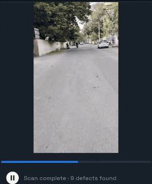
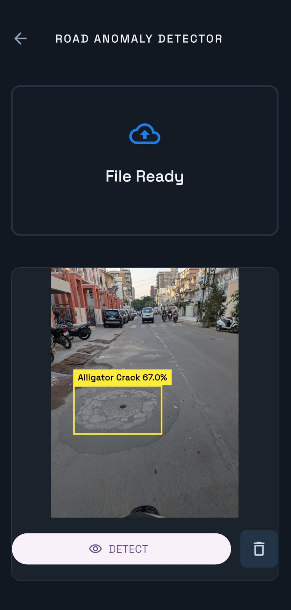
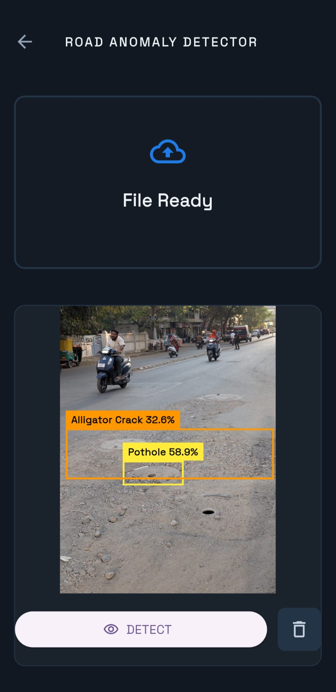
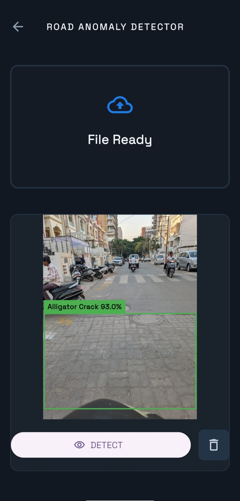

# Road Anomaly Detector

A Flutter app that finds road defects (potholes, cracks, manhole covers and more) in **photos**, **uploaded videos** and the **live camera**, running a YOLO11s model on the phone. On Android the model runs on the phone's GPU, and videos are decoded by the hardware video decoder.

## Demo

### Video detection

Upload a video and tap **START DETECTION**: the whole video is scanned first, then it plays with one stable box per defect that follows it through the frame.

<p align="center">
  
</p>

<p align="center"><a href="docs/media/video-demo.mp4">Full screen recording (MP4, 40 s)</a></p>

### Photo detection

<table>
  <tr>
    <td align="center"></td>
    <td align="center"></td>
    <td align="center"></td>
  </tr>
  <tr>
    <td align="center">Alligator crack around a manhole</td>
    <td align="center">Pothole inside an alligator-crack patch</td>
    <td align="center">Broken paved surface</td>
  </tr>
</table>

Photo boxes are coloured by confidence: green ≥ 70%, yellow ≥ 50%, orange below.

## Features

- **Photos**: pick a photo and tap **DETECT**. High-resolution photos (12 MP) are decoded natively with OpenCV in the background, with EXIF rotation applied.
- **Uploaded videos**: scan-first, like a photo but for every part of the video:
  1. **START DETECTION** scans the whole video with a progress bar (the video stays paused).
  2. Detections from each scanned frame are linked into **one track per physical defect**: one label per defect (confidence-weighted vote, so a crack doesn't flip between types), a smoothed box that follows the defect, short misses bridged, unconfirmed one-off detections dropped. Only defects confirmed at ≥ 0.50 confidence are shown.
  3. When the scan finishes the video plays from the start, with no buffering, and shows `pothole 0.88`-style red boxes while each defect is in view.
- **Live camera**: detection on the camera stream with frames rotated to match the preview, an IoU tracker that keeps boxes on the right defect, and an on-screen readout of the engine in use (GPU/CPU) and detections per second.

Detected classes: longitudinal crack, transverse crack, alligator crack, block crack, pothole, manhole cover, other corruption.

## Performance

Measured on a Google Pixel 9 (YOLO11s, 640 × 640 input):

| | Time |
|---|---|
| One detection on the GPU (LiteRT, FP16) | ~35–50 ms |
| One detection on the CPU (ONNX Runtime, 4 threads; fallback) | ~215 ms |
| 12 MP photo, decode + detection | 0.2–0.4 s |
| Scan of a 36 s 4K HEVC video (hardware decoder + GPU) | ~21 s |
| Scan of a 1080p video | faster than the video's length |

Accuracy on 60 labelled validation images (140 defects): GPU F1 0.588, CPU F1 0.594. Smaller model inputs were measured and not used: mAP50 0.604 at 640 px, 0.560 at 416 px, 0.512 at 320 px (1,000 validation images).

The GPU engine compiles its program when the app starts (about 12 s on a Pixel 9). Until it is ready, detection runs on the CPU, and the screens switch to the GPU automatically.

## How it works

```
Photo  → upload isolate:   OpenCV decode + resize ─────────────────────┐
Video  → decoder isolate:  MediaCodec → GPU downscale (FFmpeg fallback) ├─→ shared GPU engine → boxes
         → detector isolate                                            │   (YOLO11s, LiteRT GPU)
Camera → live isolate:     YUV/BGRA → upright RGB ─────────────────────┘
```

When the GPU engine is not available (still starting, unsupported device, iOS), each pipeline runs ONNX Runtime on the CPU in its own isolate.

- The three pipelines (photo, video, live) are separate; only inference is shared.
- **Video decoding** (Android): `MediaCodec` decodes straight into a GPU texture; an OpenGL ES pass rotates it and area-downscales it to the model's letterbox size, and only that small frame is read back. Frames that are not sampled are decoded and dropped. OpenCV's FFmpeg backend is the fallback (and the path on other platforms).
- **Model**: YOLO11s trained on road-defect data. Android uses `assets/models/best_gpu_fp16.tflite`; the CPU fallback uses `assets/models/best.onnx`.

## Getting started

Requirements: Flutter (Dart SDK ^3.8), Android SDK with NDK 27, an Android device on Android 7.0 (API 24) or newer. A physical device is recommended; emulators are much slower and their virtual camera can starve the CPU.

```bash
flutter pub get
```

```bash
flutter run --release
```

Grant the camera permission when the live camera opens. Use `flutter run --profile` to see per-frame timing logs (photo, video and live) in `logcat`.

### Re-exporting the GPU model

If you retrain the model, regenerate the GPU model from `best.pt` with `tool/export_gpu_model.py` (instructions in the script). The export must keep BatchMatMul unfolded: without it the GPU delegate computes YOLO11's attention block wrongly.

## Project structure

```
lib/
  screens/              UI: home, upload (photo + video), live camera, settings
  services/
    detector/           shared GPU engine, CPU fallback client, LiteRT GPU binding
    upload/             photo detection, video scan (decoder + detector), defect tracks
    live/               camera frame conversion, live inference isolate, tracker
    model_service.dart  ONNX Runtime session, YOLO decoding entry point
  utils/                letterbox preprocessing, YOLO output decoding, NMS
android/.../            HwVideoDecoder (MediaCodec → OpenGL ES downscale)
tool/                   model export script
test/                   unit tests (preprocessing, live pipeline, tracking)
```

## Tests

```bash
flutter test
```

## Known limitations

- iOS uses the CPU path (ONNX Runtime) and has not been tested on a device.
- Live camera boxes trail a fast-moving scene by about one detection; live-camera speed on the GPU has not been benchmarked on a device yet.
- 4K scanning relies on the hardware decoder; on devices where it cannot be used, the FFmpeg fallback decodes 4K at only about half real time.
